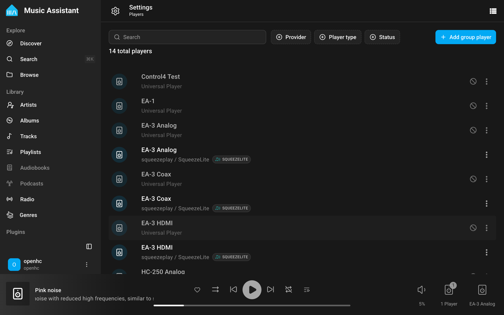

# Installing on a Control4 EA controller

There are two ways to run an EA-1, EA-3 or EA-5 on openHC. Pick one per box:

| | **A. openHC + Home Assistant** (this repo) | **B. openHC for Control4** |
|---|---|---|
| What runs on the box | Home Assistant, Music Assistant, openHC's IO, audio, Zigbee | openHC only |
| Who drives it | Home Assistant | Your Control4 system (Composer) |
| IO (relays, contacts, IR, serial) | Home Assistant entities | Control4 bindings |
| Audio outputs | Music Assistant players (AirPlay, Spotify through MA) | Control4 digital audio, AirPlay |
| Image | `openhc-ha-<board>-<version>.zip` from this repo | `openhc-<board>-<version>.zip` from openHC |

Both use the same installer, openHC's flasher. It works over the network with
no serial cable and no lid off, and it identifies the box before it writes
anything. Read openHC's
[Recovery](https://the1truejoe.github.io/openHC/shared/recovery/) page first:
it explains how each EA gets back to stock Control4.

Installing re-images the box's first eMMC partition (p1): anything on an
existing openHC install (Home Assistant's config, extensions, keys) is gone.
The factory recovery partition (p2) is never touched.

## Before either path

1. Get the flasher: `ohc-flasher` (GUI) for macOS, Windows or Linux from
   [openHC's latest release](https://github.com/The1TrueJoe/openHC/releases),
   or build the CLI (`cd openHC/flasher && cargo build --release -p ohc-flash-cli`).
   The flasher logs into the box over SSH and needs `sshpass`
   (`brew install sshpass`, or your distribution's package).
2. Find the box and its board:

   ```sh
   ohc-flash discover          # Control4 controllers on this network
   ohc-flash identify <ip>     # which board (ea3-v1, ea1-v2, ...), and what runs on it
   ```

   The GUI shows the same thing on its first screen. You need the board name
   to pick the right image.

## A. openHC + Home Assistant

### 1. Install the image

Download `openhc-ha-<board>-<version>.zip` for your board: from this repo's
Releases, or from the `images` workflow's artifacts for a commit. Then either:

- **GUI:** open the flasher, pick the box, and on the Install screen choose
  the `openhc-ha-…zip` as the image bundle. Leave **Make it a Control4
  controller again** unticked (that is path B).
- **CLI:**

  ```sh
  ohc-flash install <ip> --images openhc-ha-<board>-<version>.zip
  ```

The flasher writes the kernel, reboots into openHC from RAM, streams the
root filesystem to p1 and reboots again. The box comes back at the same
address, as `openea<n>-<mac>`.

### 2. First boot

The image is Debian with openHC's kernel, drivers and services. On the first
boot it installs Home Assistant and Music Assistant from the internet into
`/data`, which takes a while on the EA's Atom (budget 20–40 minutes). Progress:

```sh
ssh root@<ip>                      # password: openhc (change it: passwd)
tail -f /data/ha/install.log /data/ma/install.log
```

openHC's own web page is up straight away at `http://<ip>/`.

### 3. Home Assistant

Open `http://<ip>:8123` and create your account (HA's onboarding).

**The box's IO.** openHC's `iod` publishes the IO on the box's MQTT broker,
with Home Assistant MQTT discovery, so only the MQTT integration is needed:

1. Settings → Devices & services → **Add integration** → **MQTT**.
2. Broker `127.0.0.1`, port `1883`, no username or password.

A device named after the box (`openea3-…`) appears with:

| Entity | What it does |
|---|---|
| `switch.…_relay_N` | the relay; on/off switches it, state is live |
| `binary_sensor.…_contact_N` | the contact input, live |
| `notify.…_ir_N_send`, `notify.…_ir_front_blaster` | send IR: `notify.send_message` with a Pronto code as the message |
| `event.…_ir_received` | the front IR receiver; fires `received` with the Pronto code |
| `notify.…_serial_N_write` | write to serial port N |
| `select.…_serial_N_baud` | the port's baud rate |
| `event.…_serial_N_received` | bytes received (`b64`, and `text`) |
| `switch.…_zigbee_permit_join` | open Zigbee joining for 254 s |

Relays and contacts come from `iod` itself; the IR, serial and Zigbee entities
come from this image's `ohc-ha-discovery`, which runs at every start.

**Zigbee.** openHC runs the box's Zigbee radio with
[zigbee-bridge](https://github.com/pulzar-net/zigbee-bridge), which announces
every device to Home Assistant over the same MQTT. To pair one: turn on
**Zigbee permit join**, put the device in pairing mode, and it appears as a
device of its own.

**Bluetooth LE:** not yet. It needs openHC's kernel to drive the EA-3's
onboard Bluetooth (or a USB dongle) and its Bluetooth bridge's discovery
turned on; both are open.

### 4. Music Assistant

Music Assistant runs next to Home Assistant on `http://<ip>:8095`. The image
starts one squeezelite player per output (`EA-3 Analog`, `EA-3 Coax`,
`EA-3 HDMI`), playing into openHC's outputs.

1. Open `http://<ip>:8095` and create the admin account.
2. The setup wizard lists the players it found on your network. Switch off any
   you don't want Music Assistant to use (other AirPlay or DLNA speakers),
   then **Add more players** → **Squeezelite**. The box's outputs appear.

   
   

3. Phones and apps: **Settings → Plugins → Add a plugin**:
   - **AirPlay Receiver**: under *Connected players*, pick the outputs. Each
     becomes an AirPlay target named after it.
   - **Spotify Connect**: needs your Spotify account (a Premium API key, or
     the community go-librespot engine), so it is yours to set up.

   
   

4. In Home Assistant: **Add integration** → **Music Assistant**, URL
   `http://127.0.0.1:8095`, and sign in with the Music Assistant account.
   Each output becomes a `media_player`.

The image turns openHC's own AirPlay and Spotify Connect endpoints off, so
the outputs are Music Assistant's. To use openHC's instead on a box, turn them
on again in openHC's web page under **Audio**:


### Notes

- The EA's CPU (an Atom without SSE4.2 or POPCNT) cannot run code built for
  x86-64-v2. The image keeps Music Assistant's numpy at 2.3.x for that reason,
  and refuses to install torch (Music Assistant's Smart Fades and Sonic
  Analysis), which would also fill the eMMC.
- Home Assistant's backups are the way to keep its config across a reinstall.

## B. openHC for Control4 (IO and audio, no Home Assistant)

Install openHC's own image with the flasher, with **Make it a Control4
controller again** ticked, then add the box in Composer. Both steps, including
native Control4 digital audio on the box's outputs, are in openhc-control4's
README: **[Install](https://github.com/The1TrueJoe/openhc-control4#install)**.

On the command line that is:

```sh
ohc-flash install <ip> --images openhc-<board>-<version>.zip
ohc-flash control4 <ip>
```

openHC's web page (`http://<ip>/`, **Audio**) sets which network endpoints
each output offers (AirPlay, and the others openHC ships), with or without
Control4.
