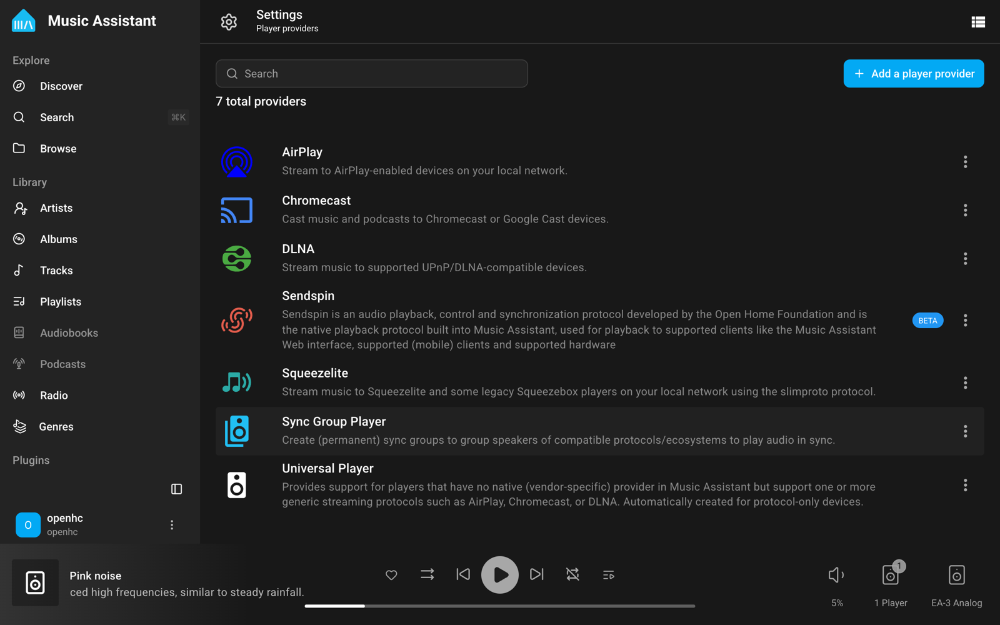
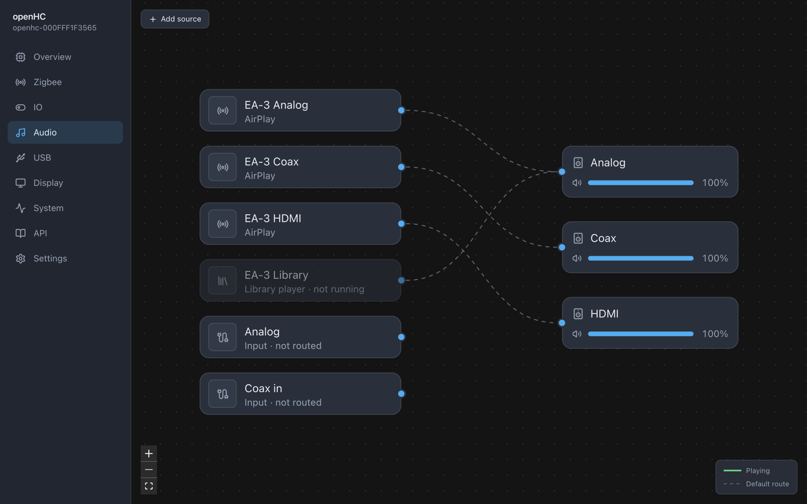
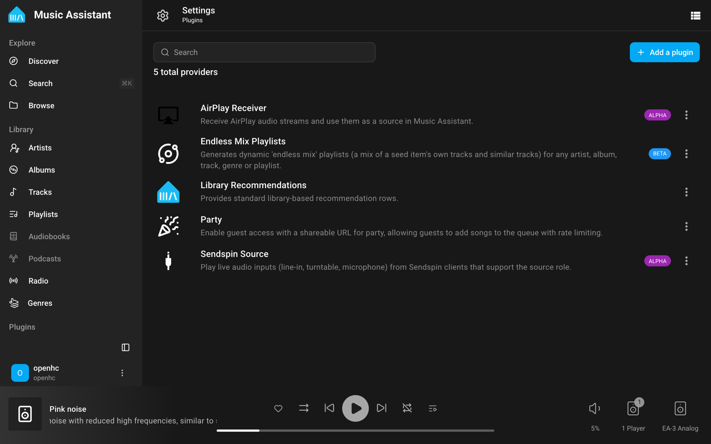

# Home Assistant on a Control4 EA controller

Two ways to use an EA-1, EA-3 or EA-5 with Home Assistant. Pick one per box:

| | **1. Home Assistant on the EA** | **2. openHC + your Home Assistant** |
|---|---|---|
| What the box runs | Home Assistant and Music Assistant, on openHC | openHC only |
| Where Home Assistant runs | on the EA | your existing server |
| IO (relays, contacts, IR, serial) | entities in the box's own HA | entities in your HA, over your MQTT broker |
| Zigbee (the EA's radio) | devices in the box's HA | devices in your HA, over your MQTT broker |
| Audio outputs | Music Assistant players on the box; AirPlay 2 | players for your Music Assistant: AirPlay 2, Sendspin, squeezelite |
| Image | `openhc-ha-<board>-<version>.zip` (this repo) | `openhc-<board>-<version>.zip` ([openHC](https://github.com/The1TrueJoe/openHC/releases)) |

Both install the same way, with openHC's flasher. It works over the network
with no serial cable and no lid off, and it identifies the box before it
writes anything. Read openHC's
[Recovery](https://the1truejoe.github.io/openHC/shared/recovery/) page first:
it explains how each EA gets back to stock Control4.

Installing re-images the box's first eMMC partition (p1). Anything on an
earlier openHC install there (Home Assistant's config, keys) is gone. The
factory recovery partition (p2) is never touched.

## Getting the flasher and finding the box

1. Get `ohc-flasher` (GUI) for macOS, Windows or Linux from
   [openHC's latest release](https://github.com/The1TrueJoe/openHC/releases),
   or build the CLI (`cd openHC/flasher && cargo build --release -p ohc-flash-cli`).
   It logs into the box over SSH and needs `sshpass`
   (`brew install sshpass`, or your distribution's package).
2. Find the box and its board:

   ```sh
   ohc-flash discover          # Control4 controllers on this network
   ohc-flash identify <ip>     # its board (ea3-v1, ea1-v2, ...) and what runs on it
   ```

   The GUI shows the same on its first screen. The board picks the image.

## 1. Home Assistant on the EA

### Install

Download `openhc-ha-<board>-<version>.zip` for your board (this repo's
Releases, or the `images` workflow's artifacts for a commit), then:

- **GUI:** pick the box, and on the Install screen choose the zip as the image
  bundle. Leave **Make it a Control4 controller again** unticked.
- **CLI:** `ohc-flash install <ip> --images openhc-ha-<board>-<version>.zip`

The flasher writes the kernel, reboots the box into openHC's installer,
writes the system to p1 and reboots again. The box comes back at the same
address, named `openea<n>-<mac>`.

If the first boot gets no network address within five minutes, the box goes
back to openHC's installer by itself (reachable over SSH as during the
install) rather than sitting there unreachable.

### First boot

The image is Debian with openHC's kernel, drivers and services. On the first
boot it installs Home Assistant and Music Assistant from the internet into
`/data`. On the EA's Atom that takes a while: budget 20–40 minutes. To follow
it:

```sh
ssh root@<ip>                      # password: openhc (change it with passwd)
tail -f /data/ha/install.log /data/ma/install.log
```

openHC's own web page is up straight away at `http://<ip>/`.

### Home Assistant

Open `http://<ip>:8123` and create your account (HA's onboarding).

**The box's IO.** openHC publishes the IO on the box's MQTT broker with Home
Assistant discovery, so only the MQTT integration is needed:

1. Settings → Devices & services → **Add integration** → **MQTT**.
2. Broker `127.0.0.1`, port `1883`, no username or password.

A device named after the box (`openea3-…`) appears with:

| Entity | What it does |
|---|---|
| `switch.…_relay_N` | the relay; switches it, state is live |
| `binary_sensor.…_contact_N` | the contact input, live |
| `notify.…_ir_N_send`, `notify.…_ir_front_blaster` | send IR: `notify.send_message` with a Pronto code as the message |
| `event.…_ir_received` | the front IR receiver: fires `received` with the Pronto code |
| `notify.…_serial_N_write` | write to serial port N |
| `select.…_serial_N_baud` | the port's baud rate |
| `event.…_serial_N_received` | bytes received (`b64`, and `text`) |
| `switch.…_zigbee_permit_join` | open Zigbee joining for 254 s |

**Zigbee.** openHC drives the EA's Zigbee radio with
[zigbee-bridge](https://github.com/pulzar-net/zigbee-bridge), which announces
every device to Home Assistant over the same MQTT. To pair one, turn on
**Zigbee permit join** and put the device in pairing mode; it appears as a
device of its own.

**Bluetooth LE:** not yet (openHC's kernel support for the EA-3's onboard
Bluetooth is open).

### Music Assistant

Music Assistant runs next to Home Assistant on `http://<ip>:8095`, with one
squeezelite player per output (`EA-3 Analog`, `EA-3 Coax`, `EA-3 HDMI`)
playing into openHC's outputs.

1. Open `http://<ip>:8095` and create the admin account.
2. The setup wizard lists the players it found on your network. Switch off
   any you don't want Music Assistant to use, then **Add more players** →
   **Squeezelite**. The box's outputs appear.

   
   

3. In Home Assistant: **Add integration** → **Music Assistant**, URL
   `http://127.0.0.1:8095`, and sign in with the Music Assistant account.
   Each output becomes a `media_player`.

**Phones.** Each output is an **AirPlay 2** receiver straight away: openHC's
own AirPlay endpoints, which play into the output beside Music Assistant.
Spotify Connect and the others can be switched on per output in openHC's web
page under **Audio**:



Music Assistant also has an **AirPlay Receiver** plugin (Settings → Plugins),
which takes AirPlay into Music Assistant's own queue and groups, and a
**Spotify Connect** plugin that needs your Spotify account. Its AirPlay
receiver is classic AirPlay, not AirPlay 2.




### Notes

- The EA's CPU (an Atom without SSE4.2 or POPCNT) cannot run code built for
  x86-64-v2. The image keeps Music Assistant's numpy at 2.3.x for that reason,
  and refuses to install torch (Music Assistant's Smart Fades and Sonic
  Analysis), which would also fill the eMMC.
- Keep Home Assistant's config across a reinstall with its own backups.

## 2. openHC + your Home Assistant

The box stays plain openHC and your existing Home Assistant (with its own MQTT
broker and, for audio, Music Assistant) uses it.

### Install

Download `openhc-<board>-<version>.zip` from
[openHC's releases](https://github.com/The1TrueJoe/openHC/releases) and install
it with the flasher (`ohc-flash install <ip> --images openhc-<board>-<version>.zip`),
leaving **Make it a Control4 controller again** unticked.

### IO and Zigbee, over your MQTT broker

openHC already speaks Home Assistant's MQTT discovery; point it at your broker:

1. On the box's web page (`http://<ip>/`), **Settings → MQTT**: turn on the
   bridge to an external broker and enter your HA broker's URL
   (`mqtt://<your-ha>:1883`) and its username and password.
2. The box's own broker then forwards everything under `openhc/<box>/` to
   yours, both ways, and its `homeassistant/` discovery messages out.

In your Home Assistant the box appears as a device with its relays (switches)
and contacts (binary sensors), and every Zigbee device on the EA's radio
appears through zigbee-bridge. IR and serial are on the same topics, for
`mqtt.publish` in your automations:

| Topic | Payload |
|---|---|
| `openhc/<box>/cmd/ir/<N>/send`, `…/cmd/ir/front/send` | a Pronto code |
| `openhc/<box>/event/ir/front/rx` | `{"pronto": …}` when the front receiver hears a code |
| `openhc/<box>/cmd/serial/<N>/write` | bytes to write |
| `openhc/<box>/event/serial/<N>/rx` | `{"b64": …}` received bytes |
| `openhc/<box>/zigbee/bridge/request/permit_join` | `{"time": 254}` opens Zigbee joining (zigbee-bridge's MQTT API) |

### Audio, for your Music Assistant

openHC's web page, **Audio**, sets what each output offers. AirPlay (AirPlay 2)
is on for every output by default; Sendspin, squeezelite and Spotify Connect
can be switched on per output (Sendspin and squeezelite from openHC
[#199](https://github.com/The1TrueJoe/openHC/pull/199)). In your Music Assistant, the matching player
provider (AirPlay, Sendspin or Squeezelite) then finds the box's outputs as
players.


