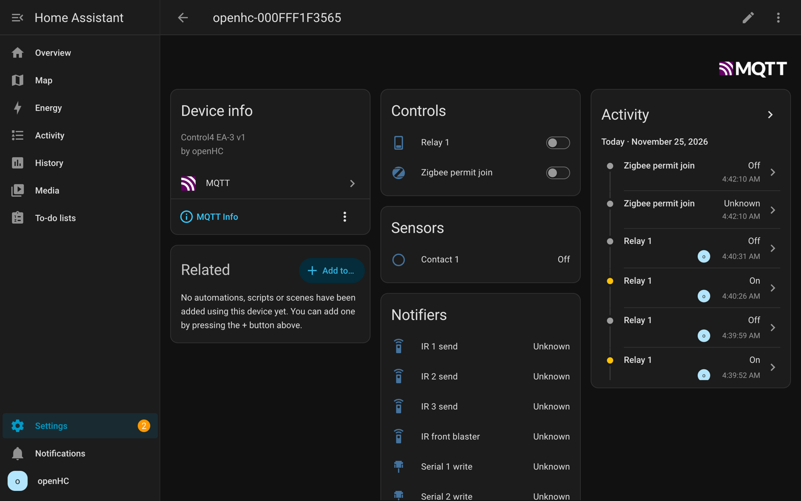
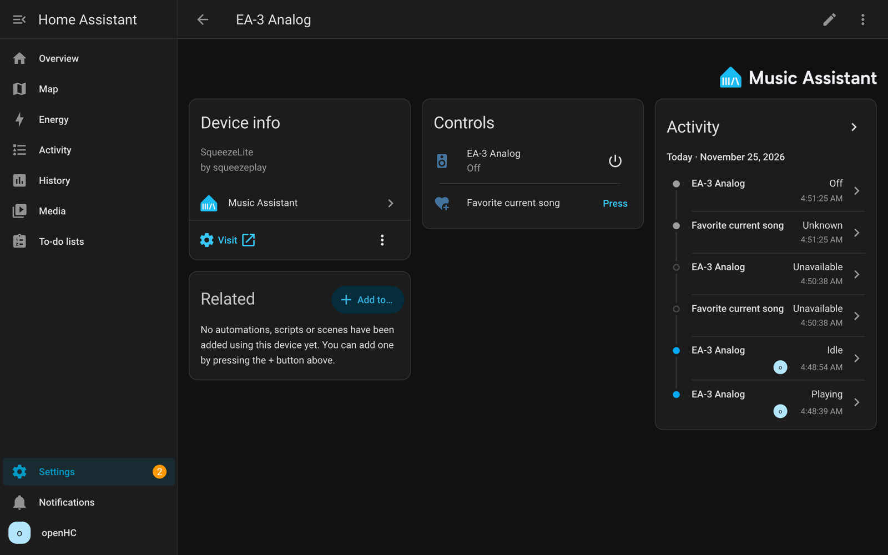
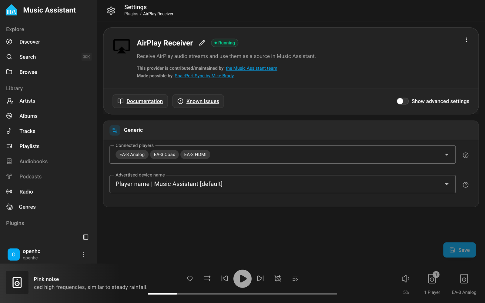
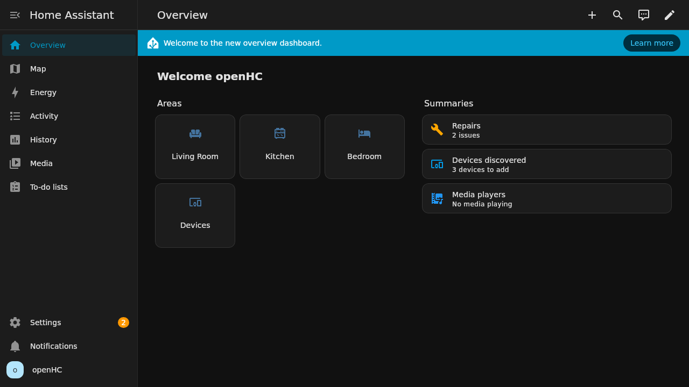

# Home Assistant on a Control4 EA controller

Two ways to use an EA-1, EA-3 or EA-5 with Home Assistant. Pick one per box:

| | **1. Home Assistant on the EA** | **2. openHC + your Home Assistant** |
|---|---|---|
| What the box runs | Home Assistant and Music Assistant, on openHC | openHC only |
| Where Home Assistant runs | on the EA | your existing server |
| IO (relays, contacts, IR, serial) | entities in the box's own HA | entities in your HA, over your MQTT broker |
| Zigbee (the EA's radio) | devices in the box's HA | devices in your HA, over your MQTT broker |
| Audio outputs | Music Assistant players on the box; AirPlay 2 | players for your Music Assistant: AirPlay 2, Sendspin, squeezelite |
| Pick in the flasher | **Home Assistant** (or **Music Assistant only**) | **openHC** |

Both install the same way, with openHC's flasher, which downloads the image
for your board by itself. It works over the network with no serial cable and
no lid off, and it identifies the box before it writes anything. Read openHC's
[Recovery](https://the1truejoe.github.io/openHC/shared/recovery/) page first:
it explains how each EA gets back to stock Control4.

Installing re-images the box's first eMMC partition (p1). Anything on an
earlier openHC install there (Home Assistant's config, keys) is gone. The
factory recovery partition (p2) is never touched.

## Getting the flasher and finding the box

1. Get `ohc-flasher` for macOS, Windows or Linux from
   [openHC's latest release](https://github.com/The1TrueJoe/openHC/releases).
   It logs into the box over SSH and needs `sshpass` on macOS and Linux
   (`brew install sshpass`, or your distribution's package).
2. Open it. Its first screen lists the Control4 controllers on your network;
   pick the EA. The next screen says which board it is (ea3-v1, ea1-v2, ...),
   which decides the image.

## 1. Home Assistant on the EA

### Install

On **What should this controller run?**, pick **Home Assistant** (or **Music
Assistant only**, below). The flasher downloads the image for your board, then
**Install**. From a terminal, the same is
`ohc-flash install <ip> --with home-assistant`.

The flasher writes the kernel, reboots the box into openHC's installer,
writes the system to p1 and reboots again. The box comes back at the same
address, named `openhc-<MAC>`.

If the first boot gets no network address within five minutes, the box goes
back to openHC's installer by itself (reachable over SSH as during the
install) rather than sitting there unreachable.

### First boot

The image is Debian with openHC's kernel, drivers and services. On the first
boot it installs Home Assistant and Music Assistant from the internet into
`/data`. On the EA's Atom that takes a while: budget 20–40 minutes. To follow
it:

```sh
ssh root@<ip>                      # password: openhc (change it with passwd)
tail -f /data/ha/install.log /data/ma/install.log
```

openHC's own web page is up straight away at `http://<ip>/`.

### Home Assistant

Open `http://<ip>:8123` and create your account (HA's onboarding).

**The box's IO.** openHC publishes the IO on the box's MQTT broker with Home
Assistant discovery, so only the MQTT integration is needed:

1. Settings → Devices & services → **Add integration** → **MQTT**.
2. Broker `127.0.0.1`, port `1883`, no username or password.

A device named after the box (`openhc-<MAC>`) appears with:

| Entity | What it does |
|---|---|
| `switch.…_relay_N` | the relay; switches it, state is live |
| `binary_sensor.…_contact_N` | the contact input, live |
| `notify.…_ir_N_send`, `notify.…_ir_front_blaster` | send IR: `notify.send_message` with a Pronto code as the message |
| `event.…_ir_received` | the front IR receiver: fires `received` with the Pronto code |
| `notify.…_serial_N_write` | write to serial port N |
| `select.…_serial_N_baud` | the port's baud rate |
| `event.…_serial_N_received` | bytes received (`b64`, and `text`) |
| `switch.…_zigbee_permit_join` | open Zigbee joining for 254 s |

**Zigbee.** openHC drives the EA's Zigbee radio with
[zigbee-bridge](https://github.com/pulzar-net/zigbee-bridge), which announces
every device to Home Assistant over the same MQTT. To pair one, turn on
**Zigbee permit join** and put the device in pairing mode; it appears as a
device of its own.



If the box ran openHC before, its radio still holds that install's Zigbee
network, whose keys went with the old system, and the bridge will not wipe a
network it does not know. Its log (`journalctl -t zigbee-bridge`) then says
*refusing to replace it*. To let it form a new one (devices paired to the old
network have to be paired again):

```sh
printf '\n[network]\nreplace_other = true\n' >> /run/ohc/zigbee-bridge.toml
sleep 15; sed -i '/^\[network\]/,$d' /run/ohc/zigbee-bridge.toml
```

**Bluetooth LE.** openHC drives the EA-3's onboard Bluetooth (an Atheros
AR3012) with [bluetooth-bridge](https://github.com/pulzar-net/bluetooth-bridge),
which this image sets to announce over the same MQTT. A device for the bridge
appears with a connection sensor. Broadcast sensors (BTHome v2 such as Shelly
BLU, Ruuvi) need no pairing: one in range shows up as a device of its own within
seconds. Everything the radio hears is also on MQTT under
`openhc/<box>/bluetooth/scan/<address>`. The setting lives in
`/data/ohc/bluetooth.env` (`OHC_BLUETOOTH_DISCOVERY=false` turns the announcing
off, then `/etc/init.d/S92ohcbluetooth restart`).

### Music Assistant

Music Assistant runs next to Home Assistant on `http://<ip>:8095`, with one
squeezelite player per output (`EA-3 Analog`, `EA-3 Coax`, `EA-3 HDMI`)
playing into openHC's outputs.

1. Open `http://<ip>:8095` and create the admin account. Music Assistant only
   takes it in the first 15 minutes after it starts; if it says setup timed
   out, restart it (`/etc/init.d/S98music-assistant restart`) and try again.
2. The setup wizard lists the players it found on your network. Switch off
   any you don't want Music Assistant to use, then **Add more players** →
   **Squeezelite**. The box's outputs appear as squeezelite players.

   Each output also shows up a second time as an AirPlay player: that is
   openHC's AirPlay 2 receiver for phones (below). Switch those three off in
   Music Assistant (Settings → Players, or in the wizard) so it plays through
   the squeezelite ones.

   
   

3. In Home Assistant: **Add integration** → **Music Assistant**, URL
   `http://<ip>:8095` (the box's address, not `127.0.0.1`: Home Assistant
   opens Music Assistant's sign-in page in your browser), and sign in with
   the Music Assistant account. Each output becomes a `media_player`.

   

**Phones.** Each output is an **AirPlay 2** receiver straight away: openHC's
own AirPlay endpoints, which play into the output beside Music Assistant.
Spotify Connect and the others can be switched on per output in openHC's web
page under **Audio**:


Music Assistant also has an **AirPlay Receiver** plugin (Settings → Plugins),
which takes AirPlay into Music Assistant's own queue and groups, and a
**Spotify Connect** plugin that needs your Spotify account. Its AirPlay
receiver is classic AirPlay, not AirPlay 2.




### The screen

The EA's HDMI output can show Home Assistant full screen: openHC's web view
(WPE WebKit on the EA's own GPU). It is off until you turn it on:

1. On openHC's web page (`http://<ip>/`), **Display**: switch it on. The URL is
   already this box's Home Assistant (`http://localhost:8123/`); any dashboard
   path works (`http://localhost:8123/dashboard-tv/0`), as does any other page.
   The theme follows the setting there (light, dark, or dark after sunset).
2. The screen logs into Home Assistant by itself: the image's HA config trusts
   the box's own address (`127.0.0.1`) and skips the login form for it. Every
   other device still gets the password form. With more than one HA user, the
   screen asks once which one to be.



A USB keyboard or mouse on the box works on the page. From Home Assistant, the
box's device has these, for a dashboard or a remote's automations:

| Entity | What it does |
|---|---|
| `text.…_screen_url` | the page the screen shows |
| `button.…_screen_up` … `_down`, `_left`, `_right`, `_enter`, `_back` | a remote's keys (Tab, Home and digits too, over MQTT) |
| `button.…_screen_reload` | reload the page |
| `notify.…_screen_type_text` | type the message into the focused field |

The web view needs about 300 MB of memory on top of Home Assistant and Music
Assistant. The image keeps a 1 GB swap file (`/var/swapfile`) so the EA-3
doesn't stall when everything runs at once.

### Music Assistant only

The flasher's **Music Assistant only** installs the same image with Home
Assistant switched off: Music Assistant, its players and AirPlay 2 work as
above, and the box's IO and Zigbee are on its MQTT broker for any other
system (the topics in part 2). To add Home Assistant later:

```sh
ssh root@<ip> 'rm /etc/ohc-apps.conf && /etc/init.d/S97homeassistant start'
```

### Notes

- The EA's CPU (an Atom without SSE4.2 or POPCNT) cannot run code built for
  x86-64-v2. The image keeps Music Assistant's numpy at 2.3.x for that reason,
  and refuses to install torch (Music Assistant's Smart Fades and Sonic
  Analysis), which would also fill the eMMC.
- Keep Home Assistant's config across a reinstall with its own backups.

## 2. openHC + your Home Assistant

The box stays plain openHC and your existing Home Assistant (with its own MQTT
broker and, for audio, Music Assistant) uses it.

### Install

In the flasher, pick **openHC** on **What should this controller run?** and
install (`ohc-flash install <ip>` from a terminal).

### IO and Zigbee, over your MQTT broker

openHC already speaks Home Assistant's MQTT discovery; point it at your broker:

1. On the box's web page (`http://<ip>/`), **Settings → MQTT**: turn on the
   bridge to an external broker and enter your HA broker's URL
   (`mqtt://<your-ha>:1883`) and its username and password.
2. The box's own broker then forwards everything under `openhc/<box>/` to
   yours, both ways, and its `homeassistant/` discovery messages out.

In your Home Assistant the box appears as a device with its relays (switches)
and contacts (binary sensors), and every Zigbee device on the EA's radio
appears through zigbee-bridge. IR and serial are on the same topics, for
`mqtt.publish` in your automations:

| Topic | Payload |
|---|---|
| `openhc/<box>/cmd/ir/<N>/send`, `…/cmd/ir/front/send` | a Pronto code |
| `openhc/<box>/event/ir/front/rx` | `{"pronto": …}` when the front receiver hears a code |
| `openhc/<box>/cmd/serial/<N>/write` | bytes to write |
| `openhc/<box>/event/serial/<N>/rx` | `{"b64": …}` received bytes |
| `openhc/<box>/zigbee/bridge/request/permit_join` | `{"time": 254}` opens Zigbee joining (zigbee-bridge's MQTT API) |
| `openhc/<box>/cmd/display/url`, `…/key`, `…/text`, `…/reload` | the HDMI web view (turned on under **Display**): open a page, press a key (`Up`, `Enter`, `Back`, ...), type text, reload |

### Audio, for your Music Assistant

openHC's web page, **Audio**, sets what each output offers. AirPlay (AirPlay 2)
is on for every output by default; Sendspin, squeezelite and Spotify Connect
can be switched on per output (Sendspin and squeezelite from openHC
[#199](https://github.com/The1TrueJoe/openHC/pull/199)). In your Music Assistant, the matching player
provider (AirPlay, Sendspin or Squeezelite) then finds the box's outputs as
players.


